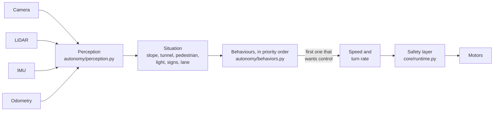

# Champion: autonomous driving stack for a small robot car

[](LICENSE)


Driving software for a small autonomous car with a camera, a LiDAR and an IMU. The car follows the lane, stops for pedestrians, red lights and STOP signs, climbs and descends a ramp, and drives through a tunnel on LiDAR alone. It does not know the layout of the track in advance: at every control step it works out the situation from its sensors and lets the most important behaviour drive.

This code started as our entry to the autonomous robot contest organised by the University of Economics Ho Chi Minh City (UEH) in 2026, where the car **placed 3rd**. The version that competed drove the track as a fixed sequence of stages and is kept unchanged at the tag [`cuoc-thi-2026`](https://github.com/mhieuz-dev/autonomous-car-jetson-ros2/tree/cuoc-thi-2026). The `main` branch is the redesign that came after the contest (see [What changed since the contest](#what-changed-since-the-contest)).

## Highlights

| | |
|---|---|
| **No fixed route** | Perception builds a picture of the situation 20 times a second, and seven behaviours compete for control in priority order. Move the ramp behind the tunnel and the car still gets through, which the contest version could not do. |
| **Perception 8x faster** | A YOLO11n detector compiled to TensorRT (FP16) runs in about 100 ms per frame end to end on the car, down from about 800 ms with onnxruntime on the CPU. |
| **Lane detector** | An 8-step detector on a bird's eye view feeds a PID on the distance to the right line, measured 0.35 m ahead of the car. In the simulator the car stays within 0.9 cm RMS of the lane centre after the tunnel. |
| **Tested without a robot** | 67 automated tests run on a built-in simulator that renders the camera, LiDAR and IMU, including a reordered track, pedestrians, red lights and STOP signs. |

## How the car decides



Every behaviour is asked at every step whether it needs control, even when a higher one is driving, so its timers stay correct. The first behaviour that says yes produces the command:

| Priority | Behaviour | Takes control when | What it does |
|---|---|---|---|
| 1 | `pedestrian` | LiDAR sees an object in a 30 cm wide band in front of the car, less than 30 cm from the bumper plus a reaction distance | Stands still until the band has been clear for 1 s |
| 2 | `traffic_light` | A red or yellow light is close enough (its box is at least 40 px tall) | Stands still until green is seen for about 1 s. After 20 s it gives up and ignores lights for 5 s, so a misdetection cannot block the run |
| 3 | `stop_sign` | A STOP sign is close enough | Stands still for 1 s, then ignores STOP for 6 s to drive past the sign |
| 4 | `tunnel` | LiDAR sees two walls at the tunnel width | Follows the centre of the corridor with LiDAR only, slows down and turns towards the open side in bends |
| 5 | `ramp` | The IMU says the car is on a ramp | Holds the heading it had at the foot of the ramp. Never stops or reverses on a ramp, so the three behaviours above are ignored there |
| 6 | `tunnel_exit` | The car has just left the tunnel | Holds its exit heading at low speed until the camera has the lane line for 5 frames in a row (at least 0.5 s, at most 2 s) |
| 7 | `lane_follow` | Always (the default) | Follows the right lane line. Keeps the line's curvature through short gaps, stops and turns right to look for the line when it is lost or jumps to the wrong line |

Under all of them, the safety layer stops the car on `Ctrl+C`, on an emergency stop file or when a sensor goes silent, limits acceleration, and corrects the turn rate with the gyro.

## How the car sees

**Lane** (`core/lane.py`, `core/lane_follow.py`). The camera image is warped to a bird's eye view with a precomputed lookup table. The right line is isolated with a top-hat filter, a threshold, morphology and a connected-component choice, then a quadratic curve is fitted and filtered over time with a Kalman filter. When no plausible line is found, the curve is moved with odometry and the IMU instead of being dropped, which keeps the car on bends where the line briefly leaves the image.

**Ramp** (`autonomy/perception.py`). A state machine on the pitch angle goes flat, up, crest, down, flat. Each change needs its condition to hold for 0.5 to 0.8 s, so bumps do not trigger it. The car also lifts its nose when it drives fast (about 30 v² degrees, measured on the real car), and this part is subtracted before the pitch is compared with the thresholds.

**Tunnel** (`core/tunnel.py`). Two walls on both sides at a known total width for 3 scans in a row mean the car is in the tunnel; 6 scans without walls mean it has left. Inside, the car steers on the offset, heading and curvature of the corridor measured from the walls.

**Lights and signs** (`core/detector.py`). A YOLO11n model with 14 classes: red, yellow and green lights, STOP, turn left, turn right, go straight, pedestrian, slope sign, tunnel entrance sign, speed limit and end of speed limit signs, and bus-lane signs. The car acts on the lights and on STOP. A detection counts only once its box is tall enough, which means it is close enough to matter.

## Try it without a robot

The simulator renders the camera, LiDAR and IMU from a synthetic track: a pedestrian, a ramp, a tunnel with a 90 degree bend, and a lane with a fake bright stripe and a stop line to confuse the lane detector.

```bash
git clone https://github.com/mhieuz-dev/autonomous-car-jetson-ros2.git
cd autonomous-car-jetson-ros2
uv venv .venv --python 3.10          # or: python3.10 -m venv .venv
uv pip install -r requirements.txt   # or: .venv/bin/pip install -r requirements.txt

.venv/bin/python run_car.py --sim --fast --no-record --max-time 70   # drive the track, about 7 s of wall time
.venv/bin/python -m pytest -q                                              # 67 tests, about 40 s
```

The log shows each decision as it happens:

```
HÀNH VI: - -> lane_follow
HÀNH VI: lane_follow -> pedestrian (người cách LiDAR 0.56 m (lần 1))
HÀNH VI: pedestrian -> lane_follow
HÀNH VI: lane_follow -> ramp (dốc up)
HÀNH VI: ramp -> lane_follow
HÀNH VI: lane_follow -> tunnel (LiDAR thấy 2 tường)
HÀNH VI: tunnel -> tunnel_exit (vừa ra hầm)
HÀNH VI: tunnel_exit -> lane_follow
```

`HÀNH VI` means behaviour. The car does not know where the track ends, so the run stops at the `--max-time` time limit (in seconds), or with `Ctrl+C`.

## Running on the car

The car needs a Jetson with ROS 2 Humble and a container named `crc_car` (change it with `CRC_CONTAINER`). Set the car's address once, then use `scripts/car.sh`:

```bash
export CRC_HOST=jetson@<car-ip>
bash scripts/car.sh run_car        # copy the code to the car and drive
bash scripts/car.sh stop              # emergency stop
bash scripts/car.sh list         # list every script and tool
python3 tools/control_panel.py     # control panel on the laptop: calibration, live views, buttons
```

`Ctrl+C` while a script is running stops the car. All behaviour parameters are in `autonomy/params.py`. To use the TensorRT engine, build it once on the Jetson itself (an engine only runs on the machine that built it):

```bash
/usr/src/tensorrt/bin/trtexec --onnx=models/best.onnx --saveEngine=models/best.engine --fp16
```

## Repository layout

| Path | Content |
|---|---|
| `run_car.py` | Entry point of the autonomous car |
| `autonomy/` | Perception (`perception.py`), behaviours (`behaviors.py`), the decision loop (`driver.py`) and all behaviour parameters (`params.py`) |
| `core/` | Shared code: lane detector, camera and bird's eye, YOLO inference, LiDAR and tunnel, IMU, PID, run frame and safety layer, simulator, logging |
| `tools/` | Single-purpose tools: sensor tests, slope measurement, PID test, line debug view, TensorRT server |
| `config/` | Camera calibration of the car |
| `models/best.onnx` | YOLO11n detector (14 classes, 640x640), AGPL-3.0 |
| `tests/` | 67 tests, most of them on the simulator |
| `scripts/car.sh`, `tools/control_panel.py` | One-command runner for the car, laptop control panel |

Code comments and log messages are in Vietnamese, since this was written by a Vietnamese team for a Vietnamese contest. The names of files, behaviours and parameters are Vietnamese too (`autonomy` is "autonomous", `perception` is "perception", `behavior` is "behaviour", `lane_follow` is "line following").

## What changed since the contest

| | Contest version (tag `cuoc-thi-2026`) | `main` |
|---|---|---|
| Structure | 8 stages S0 to S7 run in a fixed order, one file each | Perception plus 7 behaviours chosen by priority at every step |
| Track order | The tunnel stage only starts after the ramp stages | Anything can come in any order, and the car can start anywhere |
| Ramp detection | Raw pitch. In the simulator with the measured nose-up, a flat floor at 0.5 m/s reads +6.8 degrees and is reported as the foot of the ramp after 0.64 m | Pitch minus the speed-dependent nose-up, no false ramp at 0.5 m/s |
| Heading on the ramp | Assumes the ramp is aligned with the start heading | Heading at the foot of the ramp |
| Red light timeout | Stops again at the next step if the light is still red | Ignores lights for 5 s after giving up |
| After the first STOP sign past the tunnel | Replays a path recorded by pushing the car by hand | Follows the lane, no recorded path |

The lane detector, the tunnel steering law, the YOLO model and the TensorRT pipeline are the same code that ran in the contest.

## Limits worth knowing

- `main` has only run in the simulator so far. The contest version is the one that drove the real track. Parameters marked "chưa chỉnh trên xe" (not tuned on the car) in `autonomy/params.py` still need tuning on the real car.
- The simulator renders a clean synthetic track. It checks the logic and the timing, not how the vision behaves in real light.
- The detector was trained on a dataset of real photos that is not part of this repository, so the model cannot be retrained from what is here.

## License

[GNU AGPL-3.0](LICENSE). The detector in `models/best.onnx` was trained with Ultralytics YOLO11, which is released under AGPL-3.0, so the whole repository uses the same license. If you build on this code, share your changes under the same terms.
