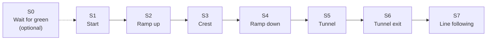
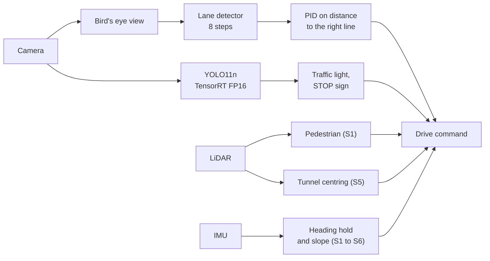

# Champion: software stack of a small autonomous car

[](LICENSE)


Complete driving software for a small autonomous car: it follows the lane, stops for lights, signs and pedestrians, climbs a ramp, drives through a tunnel on LiDAR alone, and follows the lane line again until it is stopped. The car competed in an autonomous robot contest organised by the University of Economics Ho Chi Minh City (UEH) in 2026 and **placed 3rd**.

Everything runs on the car (an NVIDIA Jetson with ROS 2 Humble in Docker), and the whole track can also be driven in a built-in simulator on a laptop, with no robot needed.

## Highlights

| | |
|---|---|
| **Perception 8x faster** | A YOLO11n detector compiled to TensorRT (FP16) runs in about 100 ms per frame end to end on the car, down from about 800 ms with onnxruntime on the CPU. GPU inference alone takes 50 ms. |
| **Lane detector** | An 8-step detector on a bird's eye view feeds a PID on the distance to the right line. In the simulator, measuring that distance at a look-ahead point of 0.35 m instead of next to the car cut the tracking error from 6.2 cm to 0.7 cm RMS. |
| **Eight stages, one file each** | Every stage of the track is a separate Python file with its own parameters. When the car moves on, the old stage is dropped completely, so for example the pedestrian logic cannot fire inside the tunnel. |
| **Tested without a robot** | 74 automated tests run on the built-in simulator, and a full map can be driven with one command. |

## How the car drives



| Stage | File | What the car does | It moves on when |
|---|---|---|---|
| S0 | `giai_doan/s0_den_xanh.py` | Optional: removed from the contest rules, so the full map starts at S1, but it still runs on its own. Stands still for 2 s to calibrate the IMU, then waits for a green traffic light seen by the YOLO model | Green is seen in 3 consecutive frames |
| S1 | `giai_doan/s1_xuat_phat.py` | Follows the right lane line. Stops for a red or yellow light, for a STOP sign, and for a pedestrian detected by LiDAR | The pitch stays above a threshold for a short time: the foot of the ramp |
| S2 | `giai_doan/s2_len_doc.py` | Holds its heading with the IMU and speeds up with the pitch. Never stops or reverses on the ramp | The pitch returns to about zero: the crest |
| S3 | `giai_doan/s3_dinh_doc.py` | Rolls over the crest holding its heading | The pitch turns negative |
| S4 | `giai_doan/s4_xuong_doc.py` | Drives down holding its heading, slowly, with no stops | LiDAR sees the two walls of the tunnel entrance |
| S5 | `giai_doan/s5_ham.py` | Drives through the tunnel on LiDAR only: it stays in the middle of the corridor, slows down for bends, and backs out of a jam by itself | The walls disappear |
| S6 | `giai_doan/s6_ra_ham.py` | Coasts out of the tunnel for 2 s on its IMU heading while the camera looks for the lane line | The 2 s are over |
| S7 | `giai_doan/s7_bam_vach.py` | Follows the right lane line. It keeps the line's curvature when the line is lost, ignores a line that jumps implausibly, and after a STOP sign can replay a path that was recorded by pushing the car by hand | It does not detect the end of the track: it runs until the car is stopped (`bash chay.sh dung`) or the 180 s limit is reached |

## How the car sees



**Lane detection** (`chung/lane.py`). The camera image is warped to a bird's eye view with a precomputed lookup table, so each frame costs one table lookup. The right line is then isolated with a top-hat filter, a threshold, morphology and a connected-component choice, and a quadratic curve is fitted and filtered over time with a Kalman filter. The camera is calibrated with a chessboard lying on the floor, and `bang_dieu_khien.py` (the control panel) walks you through it.

**Traffic lights and signs** (`chung/den_onnx.py`). A YOLO11n model with 14 classes: red, yellow and green lights, STOP, turn left, turn right, go straight, pedestrian, slope sign, tunnel entrance sign, speed limit and end of speed limit signs, and bus-lane signs. The car acts only on the lights and on STOP. It listens to the largest light in the image, and only once its box is tall enough, which means it is close enough to matter.

**Tunnel** (`giai_doan/s5_ham.py`). The tunnel is recognised by walls on both sides at a known total width. Inside, the car steers on the offset, heading and curvature of the corridor measured from the walls.

## Try it without a robot

The simulator drives the whole map on a laptop and renders the camera, LiDAR and IMU from a synthetic track.

```bash
git clone https://github.com/mhieuz-dev/autonomous-car-jetson-ros2.git
cd autonomous-car-jetson-ros2
uv venv .venv --python 3.10          # or: python3.10 -m venv .venv
uv pip install -r requirements.txt   # or: .venv/bin/pip install -r requirements.txt

.venv/bin/python full_map.py --gia-lap --nhanh --khong-ghi   # the full map, S1 to S7, in about 20 s of wall time
.venv/bin/python -m pytest -q                                # 74 tests, about 70 s
```

In the simulator, stages S1 to S6 finish and S7 follows the line until its 180 s limit, so the run ends with a timeout in S7 and exit code 1. That is expected: S7 does not detect the end of the track, it keeps following the line until it is stopped or the limit is reached.

To start from a later stage, use for example `--tu s5_ham` (any stage from `s1_xuat_phat` to `s7_bam_vach`).

## Running on the car

The car needs a Jetson with ROS 2 Humble and a container named `crc_car` (change it with `CRC_CONTAINER`). Set the car's address once, then use `chay.sh`:

```bash
export CRC_HOST=jetson@<car-ip>
bash chay.sh full_map          # copy the code to the car and drive the full map (S1 to S7)
bash chay.sh s7_bam_vach       # run a single stage
bash chay.sh dung              # emergency stop
bash chay.sh danh_sach         # list every script and tool
python3 bang_dieu_khien.py     # control panel on the laptop: calibration, live views, buttons
```

`Ctrl+C` while a script is running stops the car. To use the TensorRT engine, build it once on the Jetson itself (an engine only runs on the machine that built it):

```bash
/usr/src/tensorrt/bin/trtexec --onnx=models/best.onnx --saveEngine=models/best.engine --fp16
```

## Repository layout

| Path | Content |
|---|---|
| `giai_doan/` | One file per stage of the track, S0 to S7, plus the S7 record and replay variants |
| `chung/` | Shared code: lane detector, camera and bird's eye, YOLO inference, LiDAR, IMU, PID, simulator, logging |
| `cong_cu/` | Single-purpose tools: sensor tests, PID test, line debug view, TensorRT server |
| `calib/` | Camera calibration of the car and the recorded replay paths |
| `models/best.onnx` | YOLO11n detector (14 classes, 640x640), AGPL-3.0 |
| `tests/` | 74 tests on the simulator |
| `full_map.py`, `chay.sh`, `bang_dieu_khien.py` | Full-map runner, one-command runner for the car, laptop control panel |

Code comments and log messages are in Vietnamese, since this was written by a Vietnamese team for a Vietnamese contest. The names of files, stages and parameters are Vietnamese too (`giai_doan` is "stage", `chung` is "shared", `bam_vach` is "line following").

## Limits worth knowing

- This is contest code, written fast and tuned for one track and one car. Treat it as a reference, not as a framework.
- The detector was trained on a dataset of real photos that is not part of this repository, so the model cannot be retrained from what is here.
- Lane results quoted above (6.2 cm to 0.7 cm RMS) come from the simulator, not from measurements on the real track.
- The simulator renders a clean synthetic track. It checks the logic and the timing of the stages, not how the vision behaves in real light.

## License

[GNU AGPL-3.0](LICENSE). The detector in `models/best.onnx` was trained with Ultralytics YOLO11, which is released under AGPL-3.0, so the whole repository uses the same license. If you build on this code, share your changes under the same terms.
